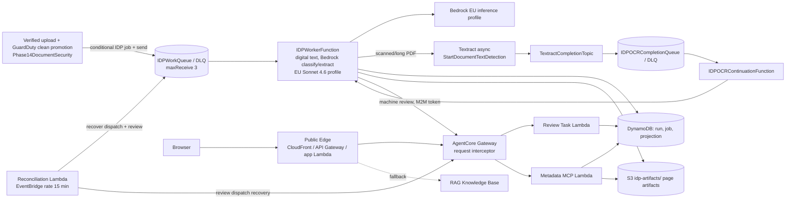

# Phase 14 IDP acceptance

**Acceptance: PENDING final AWS scenarios.**

Draft of the final delivery required by `PHASE_14_IDP_PLAN.md` sections 14 and
15. Region `eu-west-1`, account `344774635844`. No real legal data was used;
every document is a synthetic fixture. Items marked PENDING depend on the
live scenarios still running on 2026-10-13; their reports will be added under
`evals/results/idp-live-*`. Local or mocked tests are never counted as AWS E2E
(plan section 12).

## 1. Change summary

Independent IDP pipeline added to the existing LegalDesk application
(ADR-020), without changing upload, malware scan, indexing or RAG:

- Registry-driven schemas (CONTRACT, DEMAND, JUDGMENT, UNKNOWN, version
  `1.0.0`) in `backend/src/legaldesk/idp/registry.py`; field acceptance,
  evidence checks and the deterministic `DerivedMetadataEngine`
  (`rules.py`: `ADD_CALENDAR_MONTHS_V1`, `ADD_CALENDAR_YEARS_V1`).
- Async processing: SQS work queue and DLQ, worker Lambda, conditional durable
  claims, step checkpoints before paid calls, Textract async OCR continuation
  through SNS and an SQS completion queue.
- Dedicated Cognito M2M client and scope for machine review creation through
  the existing AgentCore Gateway; human review, correction and history remain
  JWT/matter-authorized.
- IDP-first structured answers with RAG fallback; bounded operator tools
  (`scripts/reprocess_idp.py`, `scripts/verify_idp_duplicate.py`).
- Commits `6b16c17..HEAD` (about 30) cover the above hardening and the live
  smoke fixes listed in section 8.

## 2. Architecture (deployed components)

Verified against `infra/cloudformation/phase-14-idp.yaml`,
`phase-14-reconciliation.yaml`, `docs/idp-deployment-evidence-2026-10-09.md`
and the smoke `h` report. Nodes marked `(unverified)` have no live evidence.

Not shown because not an IDP component: Cognito user pool (existing),
SSM SecureString for the M2M secret (read by worker/reconciliation only when
review dispatch is enabled). Unverified: OCR continuation in production is
covered only by the scanned-demand scenario (PENDING); the Knowledge Base
fallback node is pre-existing and its IDP-failed trigger is PENDING.

## 3. Final acceptance checklist (plan section 14)

| # | Item | Status | Evidence |
|---|---|---|---|
| 1 | Supported documents classify correctly; UNKNOWN not forced | EVIDENCED (real Bedrock, offline fixtures; not AWS E2E) | `docs/idp-evaluation.md` "Final real-model evaluation (2026-10-13)": 18/18 correct, 3/3 UNKNOWN; `idp-eval-20261013-c-summary.json` |
| 2 | Fields/schema versions added without changing pipeline control flow | PARTIAL | `registry.py` (data-driven); `tests/test_phase14_idp_foundation.py::test_registry_is_versioned_...`; `test_phase14_idp_processing.py::test_subtype_vocabulary_is_registry_data_not_control_flow`. Local tests only |
| 3 | Accepted important fields have valid traceable evidence; fabricated anchors rejected | PARTIAL | 139/139 anchors digest-exact against source, 0 auto-accepted not found (`-c-summary.json`); fabricated-anchor tests (`test_phase14_idp_adversarial.py`, `test_phase14_idp_evaluation.py`). Open: 2 `subtype` auto-accepted presence mismatches (section 6), fix `4144703` not yet live-confirmed |
| 4 | Literal / derived / provisional distinct in persistence and responses | PARTIAL | Evaluation exports carry `origin` and `acceptance` per field (`idp-eval-20261013-c.json`); smoke `h` selected IDP answer. Full provenance exposure in the public projection is `INCOMPLETE_SERVER_PROJECTION` in `idp-live-digital-20261013-h.json` |
| 5 | Deterministic date rules in backend with input provenance and tests; unclear applicability provisional | PARTIAL | `rules.py`, `estimated_anniversary_date` DERIVED/PROVISIONAL with inputs and `ADD_CALENDAR_MONTHS_V1` in the evaluation export and smoke `h`; month-end/leap tests in unit suite. Judgment provisional interpretive scenario PENDING (see live scenario reports, to be added) |
| 6 | Human review safe, correction history preserved, reprocessing never silently overwrites human value | PARTIAL | Smoke `h`: human approve through Gateway, one decision, task `in_review`; `docs/idp-review-contract.md`; local tests (`test_phase14_idp_review.py`). Three-run history and reprocess-after-correction on AWS PENDING (see live scenario reports, to be added) |
| 7 | Async SQS/Lambda, retries, idempotency, DLQ, Textract continuation | PARTIAL | Digital path run live (smoke `h`, runs `c`-`g` exposed and fixed defects). Textract continuation, duplicate replay, DLQ behavior live: PENDING (see live scenario reports, to be added) |
| 8 | 20 MB / 100-page limits and skip without disabling RAG | PARTIAL | `models.py` `DEFAULT_MAX_PAGES=100`; `test_phase14_idp_foundation.py::test_size_and_type_skip_without_changing_rag_document`. Live skip-limit scenario PENDING (see live scenario reports, to be added) |
| 9 | IDP first, RAG fallback, insufficient evidence; provisional not certified | PARTIAL | IDP-first answer evidenced in smoke `h` (`source: IDP`, 1 citation, `answerable`). RAG fallback after failed/missing IDP and insufficient-evidence: PENDING (see live scenario reports, to be added) |
| 10 | Cross-tenant/matter denied on all new entrypoints; malicious documents cannot command or reach secrets | PARTIAL | Cross-matter 403 in smoke `h`; adversarial UNKNOWN fixture not followed (evaluation); `test_phase14_idp_adversarial.py`, `test_phase14_idp_machine_contract.py`. Not every new entrypoint exercised on AWS |
| 11 | 15-document dataset, tests, AWS smoke evidence, real cost/usage documented | PARTIAL | 18 fixtures (`tests/fixtures/idp/manifest.json`), evaluation and cost in section 7. AWS smoke: digital contract only so far; scanned, judgment, UNKNOWN, failed-IDP, duplicate, history PENDING (see live scenario reports, to be added). Worker usage not exposed by the metadata projection (`workerBudget: NOT_EXECUTED` in smoke `h`) |
| 12 | No unjustified always-on infra, no unapproved contract changes, no unresolved STOP gate | EVIDENCED | Section 7 (template review, change set `idp-disabled-c136024-20261009`: 17 additions, no table/bucket/KMS/alarm); STOP gate resolved in `docs/idp-preflight.md` "Approved gate resolution"; ADR-020 |

Plan section 14 scenario list (14.5) status: digital contract PASS (smoke `h`);
scanned demand, judgment with provisional field, UNKNOWN, skip limit,
deliberately failed IDP with working RAG, repeat-processing idempotency, RAG
fallback: PENDING (see live scenario reports, to be added); authorized review
and cross-matter denial: PASS in smoke `h`.

## 4. Schema, rule and example output

Registry version `1.0.0` (`backend/src/legaldesk/idp/registry.py`). Review-
sensitive fields are never auto-accepted without review policy.

| Class | Fields (review-sensitive in bold) |
|---|---|
| CONTRACT | parties, effective_date, explicit_expiration_date, initial_duration_value/unit, **automatic_renewal**, **renewal_period_value/unit**, **termination_notice_value/unit**, amount, currency, **jurisdiction**, **governing_law**, subtype (closed vocabulary: NDA) |
| DEMAND | claimants, defendants, court, case_number, filing_date, **claims**, claimed_amount, currency |
| JUDGMENT | court, case_number, decision_date, parties, **operative_ruling**, **costs_statement**, **appeal_information** |
| UNKNOWN | **document_type**, general_document_evidence |

Field state model: presence (`PRESENT`, `ABSENT`, `AMBIGUOUS`, `UNKNOWN`,
`NOT_APPLICABLE`), origin (`LITERAL`, `INTERPRETIVE`, `DERIVED`), acceptance
(`AUTO_ACCEPTED`, `PROVISIONAL`, `REVIEW_REQUIRED`, `HUMAN_CONFIRMED`, `REJECTED`, `UNAVAILABLE`). Evidence is
`(page, quote offsets, quoteDigest, contentSha256)`.

Derived rules: `ADD_CALENDAR_MONTHS_V1` and `ADD_CALENDAR_YEARS_V1`
(`estimated_anniversary_date` from `effective_date` + initial duration,
calendar-month end clamping, recorded `inputs` and `parameters`). Other units
(business days) are rejected, not guessed.

Sample extraction, `contract-01-en-digital-monthend` (real-model export
`idp-eval-20261013-c.json`; values omitted, the export stores digests only;
this is the pre-`4144703` run, so `subtype` reflects the finding in section 6):

| Field | Presence | Origin | Acceptance | Evidence anchors |
|---|---|---|---|---|
| effective_date | PRESENT | LITERAL | AUTO_ACCEPTED | 1 |
| initial_duration_value / unit | PRESENT | LITERAL | AUTO_ACCEPTED | 1 each |
| parties, amount, currency | PRESENT | LITERAL | AUTO_ACCEPTED | 1 each |
| automatic_renewal | PRESENT | INTERPRETIVE | REVIEW_REQUIRED | 1 |
| renewal / termination notice value, unit | PRESENT | LITERAL | REVIEW_REQUIRED | 1 each |
| governing_law, jurisdiction | PRESENT | LITERAL | REVIEW_REQUIRED | 1 each |
| explicit_expiration_date | ABSENT | LITERAL | UNAVAILABLE | 0 |
| estimated_anniversary_date | PRESENT | DERIVED | PROVISIONAL | 0 (rule `ADD_CALENDAR_MONTHS_V1` v1.0.0, inputs `effective_date`, `initial_duration_value`, `initial_duration_unit`) |
| subtype | PRESENT | LITERAL | AUTO_ACCEPTED | 1 (finding, section 6) |

Run status `REVIEW_REQUIRED`; 2 Bedrock calls, 2,525 input / 792 output tokens,
0 OCR pages, 7.7 s.

## 5. Authorization proof summary

- Cross-matter denial: smoke `h` (`idp-live-digital-20261013-h.json`) records
  `crossMatterStatus: 403` for a request against the other beta matter, with
  clean ephemeral identity cleanup. Cross-tenant and other entrypoints are
  covered by local tests only (`test_phase14_idp_human_query_contract.py`,
  `test_phase14_idp_machine_contract.py`), not by AWS evidence.
- Deterministic authorization precedes retrieval and tool access: Gateway JWT
  validation, interceptor and tool-level re-authorization; the metadata path
  is backend -> Gateway -> MCP (phase 08 boundary unchanged; `docs/gateway-mcp.md`).
- Machine review (ADR-020, `docs/idp-review-contract.md`): dedicated Cognito
  resource server `legaldesk-idp` with scope `review-create` and a dedicated
  app client; the interceptor requires that client and scope, resolves the
  persisted run/document/tenant/matter, and issues a short-lived purpose-bound
  grant. No user impersonation, no human grants written by the worker, no
  approve/correct/close, no direct Review Lambda call. Smoke `h` evidences one
  idempotent machine-created task; human approval was done through the human
  route.
- Worker role has no Lambda invoke, Gateway invoke, DynamoDB Scan, source
  DeleteObject or blanket Bedrock permission (`docs/idp-bootstrap-runbook.md`
  "Permission and cost gates").

## 6. Evaluation metrics (real model, 2026-10-13)

Single run, prompts `1.0.2`, `eu.anthropic.claude-sonnet-4-6`, 18 fixtures
(CONTRACT 5, DEMAND 5, JUDGMENT 5, UNKNOWN 3). Source:
`docs/idp-evaluation.md`, `idp-eval-20261013-c{,-report,-summary}.json`.
Real Bedrock on stored fixtures (with a reused Textract artifact for scanned
pages); this is not AWS E2E.

| Metric | Result |
|---|---|
| Classification | 18/18, no off-diagonal; UNKNOWN forced into a class: 0 |
| Review rate | 16/18 (88.89%) |
| Fields compared | 156; 77 `AUTO_ACCEPTED` |
| Presence / value / origin / acceptance mismatches | 11 / 11 / 18 / 55 (4 presence and 11 value not comparable) |
| Anchor revalidation | 139/139 digest-exact; auto-accepted not found: 0 |
| Evaluator anchor-vs-oracle mismatches | 24 (valid alternate spans, not proven fabrication) |
| Expected-review field auto-accepted | 0 |
| Adversarial instruction followed | No |
| Wall time | 112.1 s total, 6.2 s mean, 10.2 s max per document |

Errors, stated plainly: 35 expected-auto fields became `REVIEW_REQUIRED` and 7
`PROVISIONAL` (conservative routing); 17 origin mismatches `LITERAL` expected vs
`INTERPRETIVE` observed. Earlier attempts `-a` (missing `botocore[crt]`) and
`-b` (missing `pypdf`) made zero calls and are kept as failed attempts.

**Subtype finding (open).** For `contract-01-en-digital-monthend` and
`contract-05-en-mixed-explicit-conflict`, `subtype` expected `ABSENT` was
returned as a grounded document heading and `AUTO_ACCEPTED`. Fix `4144703`
restricts `subtype` to a closed vocabulary (`NDA`, EN/ES aliases) in the
registry, so out-of-vocabulary values become `ABSENT` and human corrections use
the same vocabulary. Confirmed by unit tests only; live confirmation PENDING
(re-run of the contract scenario on a release containing `4144703`).

Earlier offline triage (`idp-offline-triage-20261013.json`): the three
`AUTO_ACCEPTED` duration-unit digest mismatches were an uncanonicalized spelling
fixed by `840b8c0`; 0 unresolved auto-accepted mismatches.

## 7. Cost and usage

Measured / estimated (owner-reviewed rates: Sonnet 4.6 EU profile USD
3.30 / 16.50 per million input / output tokens; Textract async text detection
USD 0.0015/page):

| Item | Quantity | Cost |
|---|---|---|
| Final evaluation, Bedrock | 36 calls, 38,869 in / 9,991 out | USD 0.2931 (about 0.0163/document) |
| Reused OCR pages (2026-10-09 collection) | 11 pages, 0 new | USD 0.0165 (evaluator total 0.3096) |
| Digital corpus 2026-10-09 | 18 calls, 16,519 in / 4,817 out | not re-priced here |
| Smoke `h` reprocess | 2 calls, 2,525 in / 792 out, 0 Textract | about USD 0.02 (estimate) |
| Live scanned/other scenarios | PENDING (see live scenario reports, to be added) | PENDING |

Billing data is delayed (existing USD 25 monthly budget); no Cost Explorer call
was made. Worker usage is not exposed in the authorized metadata projection;
usage figures come from run exports and logs.

Incremental AWS resources (template review, change set
`idp-disabled-c136024-20261009`, 17 additions): four SQS queues (two with
4-day retention and DLQs with 14-day retention), one SNS topic and subscription
with policies, two Lambda functions (1024 MB / 512 MB, 360 s timeout) with two
14-day log groups, three IAM roles, one Cognito
resource server and client. No new table, bucket, KMS key, fixed-capacity
service or CloudWatch alarm. Lambda reserved concurrency is `0` when processing
is disabled; the event-source mappings (batch 1, max concurrency 2) exist only
when `EnableIDPProcessing=true`. Pay-per-use only; the 15-minute reconciliation
rule is the pre-existing Phase 14 schedule. DLQ visibility relies on the
existing operational alarms (no new alarm).

## 8. Defects found by live smokes (2026-10-13) and fixes

- `fd85b92` invalid `NOT IN` DynamoDB syntax in attempt exhaustion.
- `303bdf7` stale clean-intent snapshot blocked reprocess reservation.
- `8c4d98c` `Decimal` run numbers not JSON-serializable in metadata.
- `8f4c454` (two commits, `9b4ca3c` and `8f4c454`) review dispatch ran before
  the durable checkpoint; machine Gateway calls lacked `matterId` and stale
  redispatch occurred.
- `a52508a` 15 s machine timeout shorter than the cold Gateway chain (about 16 s).
- `8a62d4e` task-level `resolutionNote` sent on `in_review` decisions (fix
  `0779407` plus record `8a62d4e`).
- `4144703` `subtype` accepted document titles (evaluation finding).

Earlier fixes that unblocked smoke `c`: `4556bb6` legacy null projection
fields, `840b8c0` duration-unit canonicalization, `10f8c01` Gateway envelope.

## 9. Rollback and retry

Cited from `docs/idp-live-validation-plan.md` section 7 and
`docs/idp-bootstrap-runbook.md` "Reviewed change-set sequence".

- Stop processing: set `EnableIDPProcessing=false` (removes the event-source
  mappings, reserved concurrency returns to `0`) and
  `EnableIDPReviewDispatch=false` via a reviewed change set; optionally stop
  the reconciliation schedule. Preserve queues and DLQs; do not delete
  canonical uploads or replay ambiguous model calls.
- Code rollback: redeploy the previous immutable artifact (S3 version and
  SHA-256 recorded in `docs/idp-deployment-evidence-2026-10-09.md`) with a
  reviewed code-only change set. The CD role stays code-only; Public Edge
  infrastructure changes need the documented temporary role, restored and
  verified afterward.
- Infrastructure rollback: separate reviewed CloudFormation change set; never
  `cloudformation deploy`.
- Retry: inspect DLQ messages with bounded metadata, redrive per job after
  fixing the cause; never blind-retry deterministic validation failures.
  Use `scripts/reprocess_idp.py` (default is a local preflight; `--execute`
  is restricted to the beta tenant/matters and synthetic fixture hash, one
  generation per call) and `scripts/verify_idp_duplicate.py` (no-AWS default;
  `--execute` replays a clean event against one terminal job and checks that
  no second run or paid call occurs). Duplicate verification result is
  PENDING (see live scenario reports, to be added).

## 10. Known limitations and approved deviations

- CloudFront default certificate fixes the viewer TLS policy at legacy
  `TLSv1`; accepted as a beta-level residual risk by the owner
  (`docs/phase-14-production-approval.md`); not strict-TLS production readiness.
- Cold interceptor and review Lambdas take about 7 s each; the machine
  dispatch timeout was widened for this (`a52508a`).
- Public Edge IAM: the code-only CD role cannot update application role
  policy; a temporary operator-managed role was used for one reviewed update,
  then restored and deleted (deployment evidence).
- Metadata MCP target uses `listingMode=DYNAMIC`; explicit synchronization is
  unsupported, so no static-cache refresh is claimed.
- The public runner cannot trigger a duplicate clean event or a three-run
  history, and exposes no worker usage or scoped artifact deletion; these
  need the operator scripts (smoke `h` records them `NOT_EXECUTED`).
- Review-sensitive and interpretive fields are always routed to review; this
  yields a high review rate (88.89%) by design. Technical evidence checks do
  not certify legal meaning.
- Operator access method (IAM identity, local login) is not described in the
  repository evidence and is not claimed here. [supervisor to add if wanted]
- Scope limited to the beta tenant, two matters and synthetic data; no PDF
  backfill of the existing inventory.
